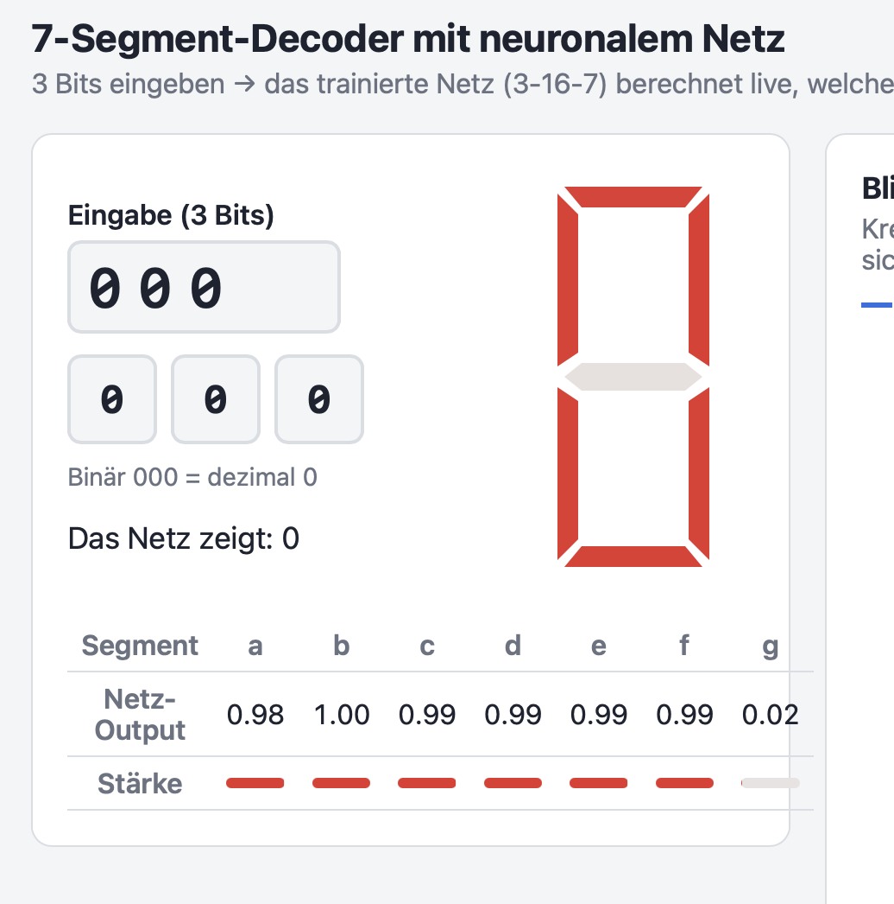
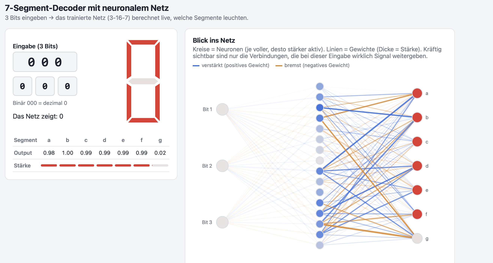

::: {.callout-note appearance="simple"}
**Fach:** INSY, 5. Klasse, HTL Braunau · **Netz:** 3-16-7, Sigmoid, SGD ·
**Werkzeuge:** Python 3.13 (nur Standardbibliothek), HTML/JavaScript, VS Code, Claude Code, Quarto
:::

# Angabe

Grundlage ist das Aufgabenblatt `4AHITS_NN_from_scratch.pdf`. Es verlangt:

- **Theorie:** Forward Pass, Backward Pass (Backpropagation), Sigmoid als Aktivierungsfunktion,
  mittlerer quadratischer Fehler (MSE) als Fehlermaß und Training mit Stochastic Gradient Descent (SGD).
- **Part 1:** Ein neuronales Netz selbst programmieren, ohne fertige KI-Bibliothek. Es besteht aus den Klassen
  `Neuron`, `Layer` und `NeuralNetwork` und hat Methoden für Training, Vorhersage und Export/Import.
- **Part 2:** Das Netz zuerst auf **XOR** und danach auf einen **7-Segment-Decoder** trainieren.
  Es wird exportiert, wieder geladen und dann noch einmal getestet.
- **Part 3–6** (noch offen): Vergleich mit TensorFlow, Vorhersage in C, Einsatz auf einem ESP32 mit echter Anzeige.

**Unser Ziel darüber hinaus:** Auf einer Webseite gibt man z. B. `001` ein, das trainierte Netz rechnet live,
und die 7-Segment-Anzeige zeigt „1“. Man soll dabei auch *sehen*, was im Netz passiert.

# Plattform & Werkzeuge

| Bereich | Verwendet |
|---|---|
| Betriebssystem | macOS 27 |
| Editor | Visual Studio Code |
| KI-Assistent | Claude Code (VS-Code-Erweiterung), Modell Claude Opus |
| Netz | Python 3.13, **nur Standardbibliothek** (`random`, `math`, `json`, `os`) |
| Webseite | HTML, CSS, JavaScript ohne Framework, Grafiken als SVG |
| Webserver | `python3 -m http.server` (in Python eingebaut) |
| Browser | VS Code „Simple Browser“ bzw. Safari |
| JS-Test ohne Browser | `osascript -l JavaScript`, die eingebaute JavaScript-Engine von macOS |
| Dokumentation | Quarto 1.10 + Quarto-Erweiterung für VS Code |

Quarto ist die einzige Software, die wir zusätzlich installiert haben, und zwar nur für diese Dokumentation.
Das Netz und die Webseite laufen ohne jede externe Bibliothek.

# Projektstruktur

```
5 Klasse/
├── Information/                 alles zum Lesen
│   ├── 4AHITS_NN_from_scratch.pdf   Angabe
│   ├── CLAUDE.md                Projektregeln für den KI-Assistenten
│   ├── PLAN.md                  freigegebener Plan
│   ├── token.md                 geschätzter KI-Verbrauch pro Aufgabe
│   ├── DOKUMENTATION.qmd        diese Dokumentation (Quelle)
│   ├── DOKUMENTATION.html       diese Dokumentation (gerendert)
│   └── bilder/                  Screenshots
└── Code/
    ├── nn.py                    das neuronale Netz (Part 1)
    ├── train_xor.py             XOR-Training (Part 2, Step 1–2)
    ├── train_7seg.py            7-Segment-Training (Part 2, Step 3–4)
    ├── index.html               interaktive Webseite
    ├── *.json / *.txt / *.h     Exporte der trainierten Netze
    ├── seven_segment_weights.js Gewichte für die Webseite
    └── seven_segment_history.js Trainingsverlauf für den Zeitraffer
```

# Das neuronale Netz (`nn.py`)

Die Struktur folgt dem PDF:

- **`Neuron`** hat Gewichte und einen Bias (eine Grundneigung, die das Neuron auch ohne Eingabe hat).
  Es rechnet aus seinen Eingaben einen Wert und drückt diesen mit Sigmoid zwischen 0 und 1.
- **`Layer`** fasst mehrere Neuronen zu einer Schicht zusammen.
- **`NeuralNetwork`** verbindet die Schichten:
  - `forward` / `predict`: Die Eingabe läuft Schicht für Schicht durch das Netz.
  - `backward`: Der Fehler wird von hinten nach vorne zurückgegeben, und jedes Gewicht wird ein Stück korrigiert.
  - `train`: Wiederholt das über viele Epochen, die Beispiele jedes Mal in zufälliger Reihenfolge (SGD).
  - Export und Import: `dump_json`, `load`, `dump_txt`, `dump_initfile` (C-Header) und `dump_js` (für die Webseite).

```{mermaid}
flowchart LR
  A["3 Bits<br>z. B. 001"] --> B["16 versteckte<br>Neuronen"]
  B --> C["7 Ausgaben<br>a – g"]
  C --> D{"Wert > 0.5?"}
  D -->|ja| E["Segment leuchtet"]
  D -->|nein| F["Segment aus"]
```

**Wie das Lernen ungefähr funktioniert:** Am Anfang sind alle Gewichte zufällig, und das Netz rät nur.
Bei jedem Beispiel vergleicht es seine Ausgabe mit der richtigen Antwort. Dann schiebt es alle Gewichte ein
kleines Stück in die Richtung, in der der Fehler kleiner wird. Nach tausenden Wiederholungen stimmen die Ausgaben.

# Training & Ergebnisse

## XOR

Netz **2-2-1**, 20 000 Epochen, Lernrate 0.1, Seed 42. Alle 4 Fälle sind richtig, und das exportierte und
wieder geladene Netz liefert dieselben Werte.

## 7-Segment-Decoder

Netz **3-16-7**, 20 000 Epochen, Lernrate 0.1, Seed 42. Die Trainingsdaten sind die Segmentmuster der
Ziffern 0–7 aus der Tabelle im PDF.

| Eingabe | Ziffer | Segmente laut Netz | Ergebnis |
|---|---|---|---|
| 000 | 0 | a b c d e f | ✓ |
| 001 | 1 | b c | ✓ |
| 010 | 2 | a b d e g | ✓ |
| 011 | 3 | a b c d g | ✓ |
| 100 | 4 | b c f g | ✓ |
| 101 | 5 | a c d f g | ✓ |
| 110 | 6 | a c d e f g | ✓ |
| 111 | 7 | a b c | ✓ |

Die Segmente, die leuchten sollen, liegen bei 0.98–1.00, die anderen bei 0.00–0.03. Das Netz ist sich also sehr sicher.

## Lernverlauf

| Zeitpunkt | Fehler (Loss) | richtig erkannt |
|---|---|---|
| vor dem Training | 0.97 | 0 / 8 |
| Epoche 66 | 0.59 | 1 / 8 |
| Epoche 356 | 0.30 | 6 / 8 |
| Epoche 1 907 | 0.02 | 8 / 8 |
| Epoche 20 000 | 0.0005 | 8 / 8 |

Schon nach etwa 1 900 von 20 000 Epochen ist alles richtig. Der Rest des Trainings macht das Netz nur noch *sicherer*.

# Die Webseite (`Code/index.html`)

| Bereich | Funktion |
|---|---|
| **Fig. 1 – Decoder** | 3 Bits eingeben oder anklicken. Die 7-Segment-Anzeige leuchtet, darunter stehen die Rohwerte a–g. |
| **Fig. 2 – Blick ins Netz** | Neuronen und Gewichte als Grafik. Hover-Infos zu jedem Neuron und jeder Linie, dazu der Schritt-für-Schritt-Modus. |
| **Fig. 3 – Wahrheitstabelle** | Alle 8 Eingaben mit Soll-Anzeige, Netz-Anzeige und Sicherheit, die Zeilen sind anklickbar. |
| **Fig. 4 – Training im Zeitraffer** | Regler und Abspielknopf über 55 Momentaufnahmen, dazu die Fehlerkurve. Die ganze Seite rechnet mit dem gewählten Stand. |

Die Seite enthält **keine fertige Lösungstabelle**. Sie rechnet mit den exportierten Gewichten selbst nach.

# Gedankengänge & Entscheidungen

In diesem Kapitel steht, *warum* wir etwas so gemacht haben und welche Alternativen es gab.

## Warum 3 Bits statt 4?

Das PDF sieht 4 Eingangsbits vor (0–9 bzw. 0–F). Wir haben uns für 3 Bits entschieden, weil

- dann **jede mögliche Eingabe** (000–111) eine gültige Ziffer ist. Bei 4 Bits gäbe es für 0–9 sechs
  Eingaben, die keine Ziffer sind, und man müsste festlegen, was die Anzeige dann zeigt.
- das Netz kleiner ist (3-16-7). Damit ist auch die Grafik „Blick ins Netz“ noch übersichtlich.
- das Grundprinzip genau gleich bleibt. Die Klassen aus dem PDF funktionieren für jede Größe.

## Warum nur die Standardbibliothek?

Die Aufgabe heißt „from Scratch“. Mit NumPy oder TensorFlow würde die Bibliothek die eigentliche Arbeit
erledigen. So sieht man in jeder Zeile, was passiert. Zusätzlich muss nichts installiert werden, und der
Code läuft auf jedem Rechner mit Python. TensorFlow kommt erst in Part 3, und dort als Vergleich.

## Warum ein fester Seed (42)?

Die Startgewichte sind zufällig. Ohne festen Seed käme bei jedem Lauf ein etwas anderes Netz heraus, und man
könnte Ergebnisse nicht vergleichen. Mit Seed 42 liefert jedes Training **byte-genau dieselben Gewichte**. Das
haben wir nach dem Einbau der Trainings-Aufzeichnung auch geprüft: Die neue JSON-Datei war identisch mit der alten.

## Warum rechnet die Webseite selbst?

Wir hätten die 8 Ergebnisse auch einfach als Tabelle in die Seite schreiben können. Dann würde aber nicht
das Netz rechnen, sondern nur nachgeschlagen. Stattdessen exportiert Python die Gewichte, und die Seite macht
denselben Forward Pass in JavaScript. Mit der eingebauten macOS-JavaScript-Engine haben wir geprüft, dass
JavaScript dieselben Zahlen liefert wie Python.

**Problem dabei:** Eine HTML-Datei, die direkt geöffnet wird (`file://`), darf keine JSON-Datei nachladen.
**Lösung:** Die Gewichte werden zusätzlich als `.js`-Datei exportiert, die die Seite per `<script>` einbindet.

## Warum das Design geändert wurde

Das war die größte Änderung, deshalb beschreiben wir sie ausführlicher.

### Ausgangslage

Die erste Version war ein helles, schlichtes Standard-Layout mit weißen Karten und roter Anzeige. Sie hat
funktioniert, hatte aber zwei Probleme.

{width=60%}

1. **Layoutfehler:** Im schmalen VS-Code-Browser ragte die Tabelle aus der Karte hinaus, und der Bereich
   „Blick ins Netz“ wurde abgeschnitten. Die Ursache: Die linke Spalte war fest auf 440 px begrenzt, die
   Tabelle war aber breiter. Das haben wir zuerst behoben, mit festen Spaltenbreiten und einem früheren Umbruch.



2. **Austauschbar:** Nach der Korrektur war die Seite sauber, sah aber aus wie jedes beliebige Dashboard.
   Nichts daran hat gezeigt, dass es um Elektronik und einen *Decoder* geht. Das Ziel war deshalb, dass sich
   die Seite **von anderen Dingen abhebt** und gleichzeitig **mehr erklärt**.

### Welche Varianten wir überlegt haben

| Variante | Idee | Warum (nicht) gewählt |
|---|---|---|
| Elektronik-Labor | dunkle Platine, LEDs, Kippschalter | passt thematisch, wirkt aber schnell verspielt |
| Neon / Futuristisch | schwarz, leuchtende Glow-Effekte | auffällig, aber eher „Gaming“ als Technik und schwerer lesbar |
| **Blueprint / Datenblatt** | blaues Millimeterpapier, weiße Linien, „FIG. 1“ | **gewählt** |

### Warum Blueprint

- **Es passt zum Thema.** Ein 7-Segment-Decoder ist ein Bauteil, und Bauteile werden in Datenblättern und
  Schaltplänen beschrieben. Die Seite sieht deshalb aus wie das Datenblatt *unseres* Decoders, mit
  Schriftfeld, nummerierten Abbildungen und Bemaßung der Segmente a–g.
- **Es passt zur Schule.** An einer HTL kennt man technische Zeichnungen, der Stil wirkt sachlich statt verspielt.
- **Es strukturiert.** Die Rahmen „Fig. 1–4“ teilen die Seite in klare Abschnitte. Das wurde nötig, weil die
  Seite durch die neuen Funktionen von 2 auf 4 Bereiche gewachsen ist.
- **Die Farben bekommen eine feste Bedeutung,** die überall gleich ist:
  - **Cyan** steht für Eingabe und verstärkende Gewichte
  - **Koralle** steht für bremsende Gewichte
  - **Gelb** steht für ein leuchtendes Segment

  In der ersten Version war Rot sowohl die Farbe der Anzeige als auch fast die der Gewichte. Jetzt kann man
  die Farben nicht mehr verwechseln.
- **Die Leuchtstärke zeigt die Sicherheit.** Ein Segment leuchtet umso kräftiger, je sicherer sich das Netz
  ist. Ausgeschaltete Segmente sind nur gestrichelt umrandet, wie auf einer Zeichnung.

### Warum diese vier neuen Funktionen

Das Design allein erklärt noch nichts. Deshalb sind vier Funktionen dazugekommen, jede mit einer bestimmten Frage dahinter:

| Funktion | Frage, die sie beantwortet |
|---|---|
| **Hover-Infos** | „Was bedeutet diese eine Linie bzw. dieses eine Neuron genau?“ Man sieht konkrete Zahlen statt nur Farben. |
| **Schritt-für-Schritt** | „In welcher Reihenfolge rechnet das Netz?“ Man sieht den Forward Pass aus dem PDF Schicht für Schicht. |
| **Wahrheitstabelle** | „Funktioniert es bei *allen* Eingaben, und wie sicher?“ Man muss nicht alle 8 einzeln durchklicken. |
| **Training im Zeitraffer** | „Wie *lernt* das Netz eigentlich?“ Das war vorher unsichtbar: Man sah nur das fertige Ergebnis. |

Der Zeitraffer war uns am wichtigsten. Wenn man den Regler bewegt, rechnet **die ganze Seite** mit den Gewichten
von diesem Zeitpunkt. So sieht man, wie das Netz am Anfang zufällig rät (0/8) und dann Schritt für Schritt
besser wird (6/8, dann 8/8).

### Technische Entscheidungen beim Zeitraffer

- **Aufzeichnen ohne das Lernen zu verändern:** `train()` bekam einen optionalen „Callback“, also eine Funktion,
  die nach jeder Epoche aufgerufen wird und einen Schnappschuss macht. Der Trainingsablauf selbst bleibt
  gleich, das zeigen die identischen Gewichte.
- **Am Anfang dichter aufzeichnen:** Das Netz lernt am Anfang schnell und später nur noch langsam. Deshalb
  gibt es in den ersten Epochen viele Schnappschüsse und gegen Ende wenige, insgesamt 55 statt 20 000.
- **Gerundete Werte:** Die Gewichte werden auf 4 Nachkommastellen gerundet. Für die Grafik reicht das, und die
  Datei bleibt mit ca. 110 KB klein.
- **Gestauchte Achsen in der Fehlerkurve:** Der Fehler fällt von 0.97 auf 0.0005. Auf einer normalen Achse wäre
  alles nach den ersten Epochen eine flache Linie am Boden. Mit logarithmischen Achsen sieht man Anfang und Ende gleich gut.

## Warum ein KI-Assistent und welche Regeln?

Wir haben mit Claude Code gearbeitet. Damit nicht einfach Code „magisch“ entsteht, haben wir am Anfang
Regeln festgelegt (`Information/CLAUDE.md`):

- Vor jedem Schritt erklärt die KI, *was* sie macht und *grob wie* es funktioniert, ohne Formeln.
- Das PDF ist das Grundgerüst, Klassen und Methoden kommen daraus.
- Es wird nur die Standardbibliothek verwendet, und vor jeder neuen Software wird gefragt (so auch bei Quarto).
- Bei Unklarheiten fragt die KI nach. Beim Redesign hat sie z. B. drei Design-Varianten zur Auswahl gestellt,
  statt selbst zu entscheiden.
- Der Aufwand wird in `token.md` geschätzt protokolliert.

# Probleme & Lösungen

| Problem | Lösung |
|---|---|
| `file://`-Seite darf keine JSON laden | Gewichte zusätzlich als `.js` exportieren |
| Simple Browser braucht `http://` | lokaler Server `python3 -m http.server` |
| kein Node.js zum JS-Testen | macOS-Engine `osascript -l JavaScript` |
| Tabelle ragte aus der Karte | feste Spaltenbreiten, früherer Umbruch |
| keine Zwischenstände des Trainings | `on_epoch`-Callback in `train()` |
| `quarto`-Befehl nach der Installation nicht gefunden | VS Code lief schon vor der Installation, daher Quarto über den vollen Pfad `/Applications/quarto/bin/quarto` starten (oder VS Code neu starten) |

# Anleitung zum Ausführen

```bash
python3 Code/train_7seg.py
```
Trainiert und testet das Netz und erzeugt alle Exporte neu.

```bash
python3 -m http.server 8000 --directory Code
```
Startet den lokalen Webserver. Danach `http://localhost:8000/index.html` im Browser öffnen.

```bash
quarto render Information/DOKUMENTATION.qmd
```
Erzeugt diese Dokumentation als HTML.

# Ausblick

- **Part 3:** dasselbe Netz mit TensorFlow, Ergebnisse vergleichen
- **Part 4–5:** Forward Pass in C mit den exportierten `.h`-Dateien
- **Part 6:** ESP32 mit einer echten 7-Segment-Anzeige

<!-- Wird beim Rendern direkt aus token.md eingefügt – dort weiterpflegen -->

